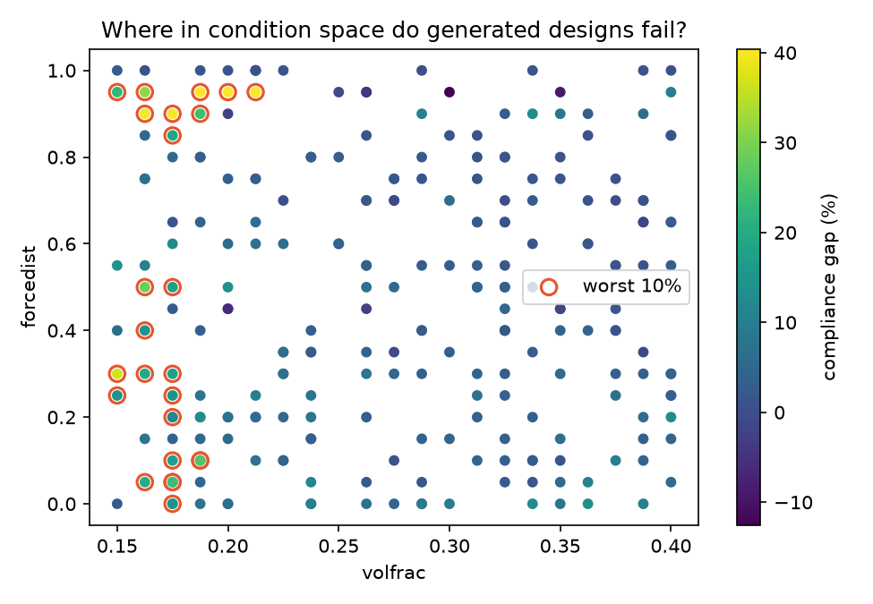
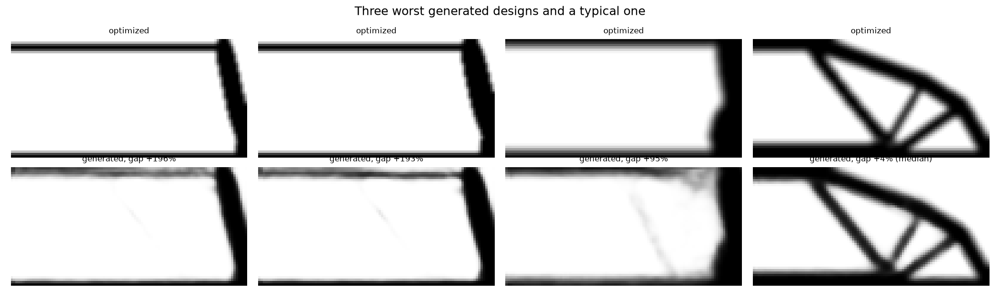
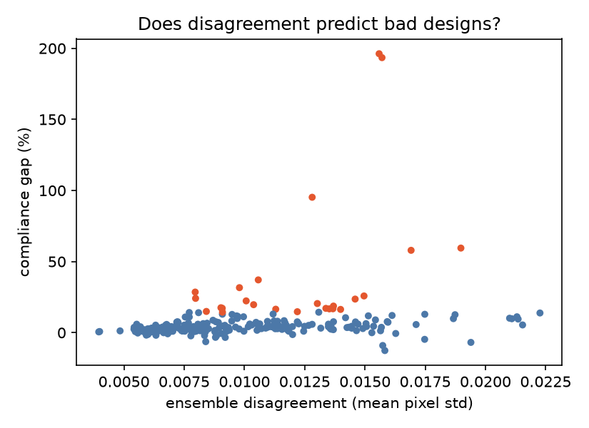

# Where does a learned inverse-design model fail, and can we see it coming?

Short self-directed study on **[EngiBench](https://engibench.ethz.ch) Beams2D** (2D topology optimization, IDEAL Lab, ETH Zurich).

1. **Where does it fail?** Every generated design is simulated and compared with the optimized design for the same condition, per condition, not only on average.
2. **Can we see it coming?** Ensemble disagreement and distance to the nearest training condition are tested as warning signals for the worst designs (AUROC), before any simulation.

## Results (5-model ensemble, 3,880 training designs, all 243 test conditions simulated)

**1. On average the generator is close to the optimizer, but not everywhere.**

| Metric | Value |
|---|---|
| Compliance gap vs optimized design, mean | 7.6% [95% bootstrap CI 5.5–10.3] |
| Median / 90th percentile / worst | 3.8% / 14.4% / 196% |
| Designs violating a constraint | 2.1% |
| Mean volume-fraction error | −0.003 (no "extra material" effect) |

**2. Failures are concentrated, not random.** 24 of the 25 worst designs (worst 10%) come from low-material conditions (volume fraction ≤ 0.20), although these are only 26% of test conditions.

| Volume fraction | n | Mean gap | 90th percentile |
|---|---|---|---|
| ≤ 0.20 | 64 | 18.0% | 27.7% |
| 0.20–0.25 | 38 | 7.1% | 8.9% |
| 0.25–0.30 | 42 | 2.7% | 7.7% |
| > 0.30 | 99 | 3.2% | 8.0% |

The most extreme failures (gap 58–196%) combine little material with a load near the right end (force position ≥ 0.9; mean gap 44% over 14 such conditions). The optimal designs there are frames with very thin members, which the decoder renders blurred or broken (see `results/worst_designs.png`).

**3. Can we see failures coming before simulating?**

| Warning signal | AUROC for worst-10% designs |
|---|---|
| Ensemble disagreement (5 seeds) | 0.72 [0.63–0.80] |
| Distance to 10 nearest training conditions | 0.50 [0.39–0.62] (no signal) |
| Volume fraction alone (lower = riskier) | 0.93 |
| All conditions, logistic regression (5-fold CV) | 0.95 |
| All conditions + ensemble disagreement (5-fold CV) | 0.96 |

- The failure regime is largely predictable from the requested conditions alone.
- Ensemble disagreement is uncorrelated with volume fraction (Spearman −0.01) and still ranks failures within the low-material regime (AUROC 0.78), so it carries complementary information; the gain on top of the conditions is small with only 25 failures.
- Distance-based novelty carries no signal here because the dataset's conditions lie on a regular grid: every test condition is equally close to the training set.

### Takeaways
- Average benchmark scores hide a concentrated failure regime: thin-member designs at low volume fraction.
- For a simple decoder, "when to fall back to the optimizer" can be decided mostly from the requested conditions, with ensemble disagreement as a secondary check.

### Evaluation pitfall found along the way
`Beams2D.simulate()` caches its load and stiffness setup after the first call on an instance. Reusing one instance for designs with different conditions silently applies the first condition's load to all of them (compliance errors up to 10^9). This notebook uses a fresh instance per simulation and checks simulated against stored compliance.

### Limitations
One problem, one deliberately simple regression decoder, one test split (243 conditions, 25 failures), no tuning. The `overhang_constraint` condition is 0 throughout the evaluated split.

### Next steps
Repeat the per-condition analysis for EngiOpt's generators (cGAN-CNN, conditional diffusion); test whether generative models recover thin members in the low-material regime; use the risk signal to warm-start the optimizer only where needed.





## Run it
```bash
conda create -n beams python=3.12 -y
conda activate beams
pip install -r requirements.txt
```
Open `notebooks/beams2d_reliability_study.ipynb`, select the `beams` kernel, set `QUICK=True` for a smoke test, then Run All.

## Built on
F. Felten et al., "EngiBench: A Framework for Data-Driven Engineering Design Research," NeurIPS 2025 Datasets and Benchmarks. https://github.com/IDEALLab/EngiBench

## Author
Jahid Hasan Jony
